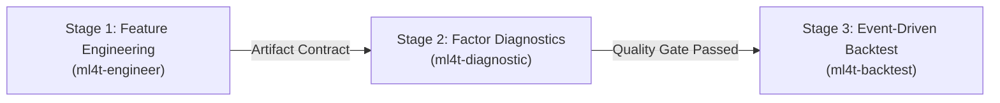

# Agent Guide: Thesis-Driven Quantitative Research

## 🚨 MANDATORY EXECUTION GATE (FAIL-CLOSED)

Before writing or running ANY code for market data, features, factor diagnostics, or backtesting:

1. **MUST proactively check and invoke the matching `ml4t-*` skill**:
   - Polars transformations → MUST invoke `ml4t-polars-patterns`
   - Feature engineering / labels → MUST invoke `ml4t-compute-features` / `ml4t-engineer`
   - Signal quality / factor diagnostics → MUST invoke `ml4t-evaluate-factor` / `ml4t-information-coefficient`
   - Strategy simulation / backtesting → MUST invoke `ml4t-run-backtest` / `ml4t-backtest`

2. **MUST use the installed verified `ml4t` libraries**:
   - Features & Labels: `from ml4t.engineer import compute_features, labeling`
   - Factor Diagnostics: `from ml4t.diagnostic import analyze_signal, Evaluator`
   - Backtesting: Subclass `ml4t.backtest.Strategy` and execute with `ml4t.backtest.Engine(feed, strategy, config)`

3. **PROHIBITION**:
   - **NEVER** hand-roll custom backtest loops, raw simulation loops, or custom metric calculators.
   - **NEVER** write ad-hoc feature loops when `ml4t.engineer` or `ml4t-polars-patterns` covers them.
   - Violation is a hard failure.

This repository is the ongoing crypto and index research workspace. Optimize for falsifiable economic hypotheses, comparable experiments, and auditable evidence, not the highest historical Sharpe. Research completion is separate from strategy approval.

## Default agent-first operating workflow

Read the [human research operating guide](docs/research_operations.md) for the
three research modes, the prompt contract, ownership, and recovery procedure.

- **Default: MVP Research.** Run the smallest decisive, source-qualified,
  causally correct and independently audited test of one economic hypothesis.
  Freeze the baseline, falsifier, data, costs and trial before observing results.
  A negative valid result is a success of the *research process*, not an alpha.
- **Validation:** Only deepen a candidate with justified MVP evidence. Use
  chronological validation, appropriate robustness/cost studies, uncertainty,
  and complete selection/trial accounting. Do not access the protected final
  test without explicit authorization.
- **Promotion:** Apply all seven **applicable ResearchPhases** and independent
  verification before proposing paper testing or another explicitly approved
  gate. The seven PipelineStages are a separate, optional technical taxonomy.
  No mode grants live-order authority or broker-execution approval.

**Role split:** Human provides research intent and high-impact approvals.
ChatGPT leads thesis/experiment choice and independently verifies evidence.
Codex implements/tests using the installed ML4T APIs, manages bounded jobs,
and reports artifacts; specialist agents provide bounded independent reviews.
One integration owner edits shared code. A worker's claim of completion is not
proof. Avoid seven separate approval prompts for ordinary research phases.

**Status discipline:** Keep process validity, statistical/economic evidence,
and broker/execution readiness separate. Preserve append-only attempts,
failures, source identity, causal timing and holdout integrity in *every* mode.
MVP reduces research breadth, never integrity standards. When a real
capability (including interrupted-job recovery) has not been demonstrated,
report its precise limitation; do not infer implementation from a runbook.

## Start every research session

When using OMP, read `docs/omp.md` for project settings and memory boundaries.
For checkpoint, replay, or agent-memory work, load `ml4t-agent-state-memory`
and its applicable dependency, `ml4t-agent-tool-contracts`.

For agent replies and written research output, follow the
[ASD-STE100 writing rules](docs/research_sessions.md#writing-standard-asd-ste100).
Apply these rules to new or revised prose. Preserve exact technical identifiers.

1. Read `docs/research_sessions.md`, the standing [CFD/perpetual market policy](docs/architecture/market_scope_policy.md), the relevant specification, latest session report, and `run_log/validation_status.json`. Inspect the working tree and preserve unrelated changes.
2. State the economic mechanism, falsifier, exact tradable instruments, baseline, and next unresolved question. Distinguish new research from review of already-observed evidence.
3. Select and read the applicable ML4T skills below before designing or implementing the experiment. Record the selection and the invariants you will verify.
4. Freeze data identities, availability/decision/fill times, development boundaries, costs, selection criteria, and planned trials before observing outcomes.
5. Run the smallest decisive experiment. Register failed and inconclusive attempts alongside successful ones. End with evidence, limitations, and the next decisive question.

## ML4T skill selection is mandatory for relevant work

Use the official [ML4T skills](https://github.com/ml4t/skills) as the first
methodology reference whenever working on ML4T data, features, validation,
backtesting, portfolio/risk, or trading research. Generic coding skills
complement these procedures; they do not replace quantitative methodology.

1. Inspect the agent's available skill descriptions and the official catalog.
   Match the task and failure mode, not merely a keyword.
2. Load the complete `SKILL.md` for each selected procedure before writing code
   or interpreting results. Load only relevant skills, not the whole collection.
3. Record skill name, local path or upstream URL/revision, reason selected,
   required invariants, and corresponding verification in session evidence.
4. Follow its method and guardrails. Prefer the referenced `ml4t-*` implementation
   where it fits the contract; inspect installed versions and actual signatures
   before calling APIs. Skill examples are guidance, not proof of API compatibility.
5. Verify the invariant independently. A skill instructs, a library implements,
   and a verifier checks; none alone establishes sound research.

Installed directories use `ml4t-<name>/SKILL.md`. Check project
`.agents/skills/`, then the current agent's advertised user skill roots
(commonly `~/.agents/skills/` or `~/.claude/skills/`). Do not assume an
available directory means the required skill is installed. Upstream files use
`<category>/<name>/SKILL.md`; cloning the grouped repository into a discovery
directory does not flatten it.

If a matching skill is missing, read its official upstream file and disclose
that it was not loaded through local discovery. If retrieval is unavailable,
record the gap and use verified library/project documentation for the method;
leave unsupported conclusions unresolved. Never claim an unread skill was used.
Installing or updating the collection is a separate environment change: inspect
the upstream installer, use an explicit target, preserve existing skills, and
record the chosen revision rather than silently updating during an experiment.

### Routing reference

Names below are upstream names; installed names carry the `ml4t-` prefix.
Read descriptions to choose the subset that applies.

| Task or risk | Skills to consider |
| --- | --- |
| Acquisition, quality, universe eligibility | `fetch-data`, `validate-data`, `define-universe`, `point-in-time`, `survivorship-bias` |
| Bars, sessions, DST, index futures rolls | `build-bars`, `calendar-ops`, `continuous-futures`, `lookahead-bias` |
| Features, labels, horizon, meta-models | `compute-features`, `feature-validation`, `horizon-design`, `triple-barrier`, `meta-labels` |
| Model fitting, preprocessing, feature selection | `data-leakage`, `feature-selection`, `walk-forward-cv` |
| Overlapping labels or holding intervals | `purging-embargo`; `cpcv` when combinatorial diagnostics are justified |
| Cross-sectional signal assessment | `evaluate-factor`, `information-coefficient` |
| Parameter/model selection and repeated trials | `backtest-overfitting`, `deflated-sharpe`, `sensitivity-analysis` |
| Fills, turnover, fees, funding and impact assumptions | `run-backtest`, `cost-model`, `transaction-costs` |
| Reporting and changing market conditions | `tearsheet`, `non-stationarity`, `regime-awareness`, `drift-detection` |

For portfolio, risk, live controls, and agent engineering, consult the current
catalog's matching categories rather than inventing skill names. Crypto funding,
margin and liquidation assumptions and index product mappings still need
instrument-specific evidence; a generic skill does not supply venue facts.
For Marimo edits, also read the available Marimo notebook skill; use batch
guidance when adding scheduled or reduced-run controls.

Explicit user instructions and repository contracts govern this workspace.
If a skill conflicts, state the conflict and the adopted method; do not silently
relax point-in-time, accounting, or holdout integrity. For skill changes, evaluate
task-specific correctness, consistency and cost, including silent-failure
checks, rather than assuming more instructions improve results.

Methodology source:
[How to Design and Evaluate Skills for Research Agents](https://insights.ml4trading.io/p/how-to-design-and-evaluate-skills).

---

## 1. Executive Summary

This repository implements systematic alpha research, factor diagnostics, and event-driven backtesting. The architecture combines:
1. **Marimo Reactive Notebooks**: Reproducible, pure-Python (`.py`) notebooks modeled as Directed Acyclic Graphs (DAGs).
2. **Machine Learning for Algorithmic Trading (ML4T)**: Stage-gated research protocols preventing data leakage, lookahead bias, and multiple-testing overfitting.
3. **Polars & TA-Lib**: High-performance, vectorized data transformations with strict numerical parity against reference implementations.

---

## 2. Core Behavioral Invariants for Agents

All agents operating in this repository must adhere to three foundational rules:

### Rule 1: Reuse verified quantitative implementations
Use Polars for data processing and prefer tested `ml4t-*` implementations for supported research contracts. First-principles code is appropriate for teaching or an independent numerical oracle; label it accordingly and test equivalence where relevant. Tests may exercise actual library integrations. Do not duplicate infrastructure merely because an agent can generate it.

### Rule 2: Zero Lookahead & Survivorship Bias
Financial data must reflect only the information available at the decision timestamp ($t$).
* Never use full-dataset transformations (e.g., `StandardScaler.fit()` over entire series). Fit transformers exclusively on training windows and transform out-of-fold data.
* Never construct point-in-time datasets using backward-revised economic series or survivor-only equity universes.

### Rule 3: Mandatory Multiple-Testing Haircuts
Every tuned parameter, altered feature, or evaluated rule constitutes a statistical trial.
* Never report an optimized in-sample Sharpe ratio without adjusting for trial count.
* Use selection-aware diagnostics such as DSR and Sharpe haircuts when their assumptions and complete trial history support them. If history is incomplete, state that the adjustment is unreproducible rather than fabricating confidence.

---

## 3. The Three-Stage ML4T Pipeline

Before starting crypto or index research, changing a strategy, or reviewing historical results, read [`docs/research_sessions.md`](docs/research_sessions.md). Specify the economic hypothesis, mechanism, falsifier, and exact tradable instruments before running trials. All new sessions are `EXPLORATORY`; preserve the legacy `NOT_APPROVED` decision and historical artifacts.

Use the existing three-stage pattern where it fits the thesis; choose labels and diagnostics appropriate to the instrument, forecast horizon, and decision rule:



### Stage 1: Feature Engineering & Labeling (`ml4t-engineer`)
* **Inputs**: Cleaned OHLCV Parquet files from `data/processed/`.
* **Transforms**: Compute technical, momentum, volatility, and fundamental features. Features must be group-aware when operating on asset panels.
* **Labeling**: Choose fixed-horizon returns, path-dependent barriers, or event outcomes to match the thesis. Triple-barrier labeling with ATR scaling is an option, not a universal requirement.
* **Storage**: Persist feature matrices to `data/features/` and target labels to `data/labels/`.

### Stage 2: Signal & Factor Diagnostics (`ml4t-diagnostic`)
* **Objective**: Evaluate whether a feature contains predictive information before running a full backtest.
* **Metrics for comparable cross-sectional panels** (not mandatory for single-instrument time-series or event strategies):
  * Cross-Sectional Information Coefficient (Spearman Rank IC).
  * Information Ratio ($IC\_IR = \text{mean}(IC) / \text{std}(IC)$).
  * IC Decay profile across forecast horizons ($H \in \{1, 4, 8, 16, 32\}$ bars).
  * Quantile monotonicity and turnover analysis.
* **Evaluation**: Use chronological development and walk-forward evaluation with point-in-time inputs. Purge overlapping label/holding intervals and apply an appropriate embargo where needed. Combinatorial diagnostics do not replace chronological out-of-sample evaluation. Freeze the final test and selection rule before observing results; never tune on that period.

### Stage 3: Event-Driven Backtesting (`ml4t-backtest`)
* **Objective**: Simulate realistic order matching and portfolio performance.
* **Execution**: Strategies must implement `ml4t.backtest.Strategy` with explicit handlers (`on_data`, `on_start`, `on_end`).
* **Cost Modeling**: Use instrument- and venue-specific fees, spreads, slippage, and market impact, with crypto funding/borrow and index financing/contract rolls as applicable. Generic **2 bps commission** and **1 bps slippage** per leg are exploratory placeholders only, not validated execution costs.
* **Sharpe Calculation**: Calculate Sharpe ratios on continuous daily portfolio equity returns. Never annualize intraday per-trade returns with trade frequency multipliers.

---

## 4. Quantitative Quality Gates

Set research acceptance criteria before trials from the thesis, instrument, and evidence requirements. The thresholds below are diagnostic examples, not universal mandates or deployment approval. Cross-sectional IC applies only where the panel and forecast support it; passing these examples cannot override `NOT_APPROVED` or promote an `EXPLORATORY` session.

| Quality Gate | Metric | Minimum Acceptance Threshold | Corrective Action on Failure |
| :--- | :--- | :--- | :--- |
| **Signal Predictive Power** | Spearman Rank IC | $\ge 0.02$ with $p\text{-value} < 0.05$ | Reject feature; re-evaluate lookahead window or feature formulation. |
| **Multiple Testing Bias** | Deflated Sharpe Ratio (DSR) | $\ge 0.95$ (95% confidence) | Penalize for trial count; discard overfit parameter configurations. |
| **Overfitting Probability** | Probability of Backtest Overfitting (PBO) | $< 0.50$ via Combinatorial CV | Strategy winner is noise; simplify model and reduce parameter count. |
| **Parameter Stability** | Sensitivity Surface Plateau | $> 60\%$ of parameter neighborhood profitable | Reject knife-edge optimum; identify stable parameter regions. |
| **Transaction Survivability** | Net Return Post-Friction | Net positive under documented market-specific costs and stress assumptions | Reassess the thesis or execution economics. |

---

## 5. Marimo Reactive Notebook Invariants

Marimo notebooks are pure Python modules executed as a reactive Directed Acyclic Graph (DAG). Agents must enforce these mechanical constraints:

### 1. Global Variable Uniqueness
Each variable name can only be defined in a single cell. Defining the same global variable across multiple cells raises a runtime DAG compilation error.

### 2. Cell-Private Variable Scoping
Variables intended for local cell computation must be prefixed with an underscore (`_`).
```python
# CORRECT: Cell-scoped private variables do not pollute the global namespace
@app.cell
def compute_metrics(prices):
    _diff = prices.diff()
    _vol = _diff.std()
    feature_vol = _vol * 100  # Global variable exported to downstream cells
    return (feature_vol,)
```

### 3. Output Payload Budget
Marimo serializes visual outputs to the browser DOM. Rendering large objects crashes the client interface.
* **Limit**: Total output payload per cell must remain well below `10,000,000` bytes (10 MB).
* **Rule**: Never pass raw, high-frequency DataFrames ($> 1,000$ rows) directly into `mo.ui.table()` or unbinned Altair charts.
* **Pattern**: Aggregate or downsample time series to daily or hourly intervals before rendering visual components.

```python
# WRONG: Serializes 50,000 15m bars to JSON (causes DOM crash)
alt.Chart(df_15m).mark_line().encode(x="timestamp:T", y="equity:Q")

# CORRECT: Downsample to daily closing equity (< 2,000 points)
df_daily = df_15m.group_by_dynamic("timestamp", every="1d").agg(pl.col("equity").last())
alt.Chart(df_daily).mark_line().encode(x="timestamp:T", y="equity:Q")
```

### 4. Headless Validation
Validate notebook syntax and reactive dependencies from the command line before committing changes:
```bash
marimo check notebooks/quantified_strategies_engulfing.py
```

---

## 6. Repository Architecture & Directory Contracts

Agents must preserve the following directory taxonomy:

```text
.
├── config/
│   └── setup.yaml              # Single Source of Truth for universe, dates, costs, and gates
├── data/                       # Pipeline storage tiers (read/write access controlled)
│   ├── raw/                    # Read-only vendor market feeds (git-ignored)
│   ├── processed/              # Canonical Parquet datasets (git-ignored)
│   ├── features/               # Versioned factor matrices (git-ignored)
│   └── labels/                 # Thesis-specific target labels (git-ignored)
├── notebooks/                  # Marimo reactive research notebooks (.py)
├── run_log/                    # Experiment tracking ledger, metrics, and audit logs
├── src/                        # Modular, reusable quantitative domain logic
│   ├── __init__.py
│   └── patterns.py             # Pattern recognition with TA-Lib numerical parity
├── tests/                      # Automated unit and integration test suites
│   ├── __init__.py
│   └── test_*.py               # Pytest verification suites
├── pyproject.toml              # Dependencies, marimo runtime options, and pytest settings
├── .gitignore                  # Exclusion rules for caches, virtual environments, and data
└── README.md                   # Project overview, empirical findings, and reproduction steps
```

---

## 7. Developer & Agent Verification Runbook

Before completing any task or pushing changes, execute this verification sequence:

For documentation-only changes, review prose and links and run `git diff --check`; the code and notebook checks below apply when those surfaces change. Preserve unrelated working-tree edits and historical artifacts.

### Step 1: Run Automated Test Suites
Verify algorithmic correctness and numerical parity:
```bash
uv run python -m pytest
```
*Criteria*: Tests pass; investigate new warnings and disclose pre-existing skips or warnings. Preserve assertions and report failures rather than suppressing them.

### Step 2: Validate Marimo Reactive DAGs
Verify that no notebook cells contain syntax warnings, invalid escape sequences, or cyclical variable bindings:
```bash
uv run marimo check notebooks/quantified_strategies_engulfing.py
```
*Criteria*: Must output `0 warnings, 0 errors`.

### Step 3: Audit Git Workspace
Ensure transient caches and large data files are untracked:
```bash
git status
```
*Criteria*: Keep new transient caches, locks and bulk datasets out of commits. Preserve unrelated existing artifacts; disclose them rather than deleting them to clean the working tree.

### Step 4: Synchronize Remote Workspaces
When deploying to remote container environments (e.g., Molab):
1. Replicate directory scaffolding (`config/`, `data/`, `src/`, `tests/`).
2. Run remote unit tests (`python3 -m pytest tests`).
3. Verify remote Marimo DAG execution (`marimo check notebook.py`).

---

## 8. Anti-Patterns & Prohibitions

1. **Do not use traditional Jupyter (`.ipynb`) files**: All notebooks must remain pure Python (`.py`) files with `@app.cell` decorators.
2. **Do not hardcode parameters**: Use the applicable versioned configuration and session specification; `config/setup.yaml` remains the existing pipeline default.
3. **Account for all trials**: Follow the session guide to retain every tested variation, failure, and deviation with hashed evidence. Keep historical review distinct from preregistered trials; missing legacy records remain disclosed limitations.
4. **Do not trade unhedged low-capacity signals**: Signals with high turnover ($> 2,000$ trades) on intraday bars must incorporate realistic market impact modeling.
5. **Never model price-barrier breakout/stop entries as delayed market orders**: In intraday breakout systems, using post-hoc condition checks (`if bar['high'] >= trigger: broker.buy()`) submits a market order that executes on the next bar or bar close after the move has already occurred. This introduces severe artificial slippage and false negatives. Always use native stop orders (`OrderType.STOP` / `stop_price=trigger`) that fill at the exact designated breakout/stop level.
6. **Never reject a volatility/momentum strategy based solely on a single low-volatility regime**: Intraday momentum and breakout systems derive edge from volatility expansion regimes (e.g., 2018, 2020, 2022). Evaluating exclusively on a low-volatility grinding bull market (e.g., 2024) misdiagnoses regime cyclicality as strategy failure. Always evaluate across multi-year cycles covering both expansion and compression regimes.
