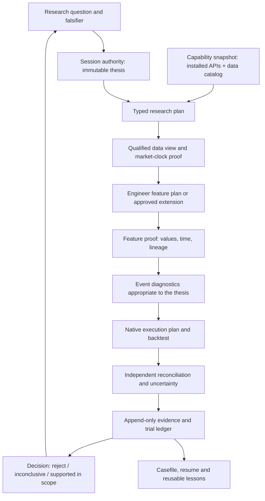

# Agent-first research control plane

**Status:** Approved M1/M2 architecture, 2026-10-12.
**Runtime status:** M1 read-only CLI and M2 strict feature contracts/gateway are
implemented. M3-M7 remain unimplemented. Existing `src/research_session.py`
and `src/catalog.py` remain the authorities for frozen sessions and datasets.
**Audience:** ChatGPT research lead, coding executor, independent auditor, and future agents.

Read this page first. Then open [contracts](research_contracts.md) only when
implementing an interface, and the [rollout plan](../plans/agent_research_system_rollout.md)
only when selecting an implementation work unit. Durable trade-offs live in
[ADRs](../adr/0001-research-capsule-authority.md). Stable domain language lives in
[CONTEXT.md](../../CONTEXT.md).

## 1. The objective and the first 60 seconds

The objective is **correct research decisions per unit of human, agent, compute,
and market-data cost**. More backtests are not the objective. A successful
agent can answer these questions without reconstructing the entire repository:

1. What precise economic question am I testing, and what is already known?
2. Which input data and library capabilities are actually usable?
3. What is the next permitted action? What evidence would make it useful?
4. What would invalidate the result or stop the run?
5. How do I prove that the result, costs, timing, and trial count are correct?
6. How do I resume without repeating an attempt or touching concurrent work?

**Design maxim:** one authority for each fact, explicit contracts between
stages, evidence before conclusions, cheap failure before expensive compute,
and structured status before prose. Do not ask an LLM to remember an invariant
that software can check.

A `research status --session <id>` is the read-only entrypoint. It renders a
short **Casefile**, not a second source of truth. A Casefile
contains: thesis/falsifier; environment and data identities; sealed/open
evaluation windows; declared and attempted trials; gate status; last verified
result; current tmux job (if any); highest-value next action; and blockers with
repair commands. Deep logs remain accessible by reference.

## 2. Repository facts that shape the design

The following were **inspected**, not inferred:

- `src/catalog.py` already resolves the canonical `ml4t-data` research
  catalog and fails closed for unqualified or non-contract-level sources.
  Individual scripts can still load source files directly and bypass it.
- `src/research_session.py` schema v1 creates immutable frozen declarations,
  checks declared Parquet inputs, and records `completed` or `failed`
  terminal trials. It hashes linked artifacts but explicitly
  **does not verify their generation or authorize trading**.
- `AGENTS.md` asks for native ML4T features/backtesting, but
  `src/pipeline.py`, `src/features.py`, and `src/backtest.py` provide
  alternative implementations. Several experiment scripts use them.
- The installed Engineer is **0.1.4**, Backtest **0.1.7**. Engineer's
  discoverable catalog contains **120 features** and native `adx`,
  `maximum`, `minimum`, and `typprice`, but **no named `vwap`**.
  Do not assume the website's 0.1.6 API equals installed 0.1.4.
- The existing workflow names *seven ML4T pipeline stages* and the
  user-facing research process also names *seven research phases*.
  These are separate taxonomies, not interchangeable step numbers.
- `.github/workflows/ci.yml` exists **locally but is not tracked by Git**
  at inspection. A local workflow is not evidence that GitHub enforces it.
- `AGENTS.md`, `README.md`, `pyproject.toml`, `uv.lock` and
  several tests already contain unrelated uncommitted work. Do not
  overwrite or absorb those edits while implementing this design.

**Consequences:** strengthen existing authority points; do not invent a
competing database, silently replace existing research-session semantics,
rewrite past artifacts, or require an agent to read hundreds of pages.

## 3. One synthetic system, seven explicit boundaries



| Boundary | Authority | Output | What it must **not** claim |
| --- | --- | --- | --- |
| Thesis | Existing frozen research session | Intent, falsifier, trial plan | Economic validity |
| Capabilities | Installed ML4T API; `src/catalog.py`; environment | Versioned capability snapshot | A source is CME just because an alias says NQ |
| Data | Resolved dataset + session/time qualification | Data View contract | An index/CFD is a futures contract |
| Features | Engineer registry or approved extension | Feature Set with availability and provenance | A custom computation is native Engineer |
| Diagnostics | Declared appropriate statistics and event labels | Diagnostic evidence | Single-asset event strategy must pass cross-sectional IC |
| Execution | Native ML4T engine + reviewed adapters | Trades, fills, cost/position ledger | OHLC touch proves a real passive fill |
| Decision | Independent evidence audit + frozen comparison rule | Scoped research decision | Completed, profitable, or PASS means live-approved |

These are **interfaces**, not seven new services. M1/M2 use a small Python
package and one CLI over existing files. No database or custom backtest was
added.

### Research phases versus pipeline stages

**ResearchPhase:** (1) thesis, (2) data, (3) alpha/event study,
(4) backtest, (5) chronological validation, (6) robustness,
(7) independent audit/decision. This is the external reporting grammar.

**PipelineStage:** setup, labels, features, evaluate, models,
backtest, synthesis, as currently used by `src/pipeline.py`.
Stages are optional implementation tasks. A non-ML event study need not
invent a model/label stage. When reporting work, always include the
taxonomy name, not merely "Phase 4" or "Stage 4".

## 4. The Research Capsule: logical identity, not a new database

A **Research Capsule** is the linked set of existing and proposed objects
for one economic hypothesis. Every derived fact points to its source.
Do not materialize a second editable copy of the truth.

```text
Research Capsule (logical view)
  session_id -> frozen research-session v1 spec [existing authority]
    config  -> optional frozen feature/execution contract [planned]
    data    -> catalog dataset identity + eligible view [planned proof]
    trials  -> declared immutable trial IDs [existing authority]
                attempts -> run leases, failures, worker logs [planned]
                artifacts -> feature / diagnostic / fill / audit evidence
  observations -> independent verification and exposures [planned]
  decision -> derived from evidence and predeclared rule [planned]
  casefile -> regenerable agent-facing summary [planned]
```

Existing `session_id`, `frozen_spec.json`, `trials/*.json` and
`run_log/validation_status.json` retain their meanings. For schema v1,
a contract file can be linked by the **existing optional `config` path**
before `init`; its contents become part of the frozen identity.
Do not add unknown keys to v1 YAML and assume they will be recognized.
A schema v2, if justified later, requires an explicit migration.

**Two principles prevent false confidence:**

- **Hash != proof**: hash verifies identity, not time validity, correct
  math, execution realism, complete trial accounting, or approval.
- **Status dimensions are separate**: source qualification, feature
  verification, simulator verification, statistical inference, holdout
  exposure, and deployment approval are not one "passed" boolean.

## 5. The agent's default interaction: ask the system, not the memory

The implemented commands route through the existing catalog/session APIs.
The remaining commands below are proposed UX and are not current commands.

```text
research plan --spec PATH            # side-effect-free plan and trial/compute budget
research freeze --spec PATH          # current session init + typed contract checks
research run --session ID --trial ID  # gated, persisted executor; one attempt
research verify --session ID         # independent proofs + comparison decision
research resume --session ID         # inspect active tmux/jobs/artifacts before action
research explain CODE               # cause, blocked boundary, safe repair
```

Current commands:

```bash
uv run python scripts/research.py doctor [--session ID]
uv run python scripts/research.py status --session ID
uv run python scripts/research.py discover --feature adx
```

These commands only read files and package metadata. `status` reads frozen
declarations and recorded trial files. It does not scan Parquet or rehash
artifacts. Use `scripts/research_session.py report` for those checks. `status`
also reports runtime visibility. When tmux cannot be inspected,
the result says visibility is unavailable and instructs the operator to check
before starting a process. `doctor --session` checks source candidates and
input coverage. It never substitutes a nearby source.

Every command should return the **same small structured envelope**:
`status, reason_code, summary, scope, evidence_refs, next_actions,
effects, costs_estimate, trace_id`. Include field-level Pydantic errors and
exact installed capability alternatives. The output can be rendered for
humans or consumed as JSON. Successful exit means a requested operation
succeeded, not that a strategy passed research.

A planned operation must declare **effects** before execution:
`READ_ONLY`, `EVIDENCE_APPEND`, `CODE_WRITE`,
`EXTERNAL_ACCESS`, `LIVE_ORDER`. Code writes and all live financial
actions remain under their existing approval/authority rules. A research
session never authorizes a live order.

### A useful error looks like this

```json
{
  "status": "BLOCKED",
  "reason_code": "DATA_SESSION_MISMATCH",
  "expected": "market order fill at 15:55 America/Chicago",
  "observed": "Dukascopy source ends at 15:14",
  "safe_actions": [
    "register a separate 15:14 CFD variant",
    "provide qualified data covering 15:55"
  ],
  "silently_substitute": false
}
```

An agent should not need to read the backtest source file to discover
this mismatch. Do not implement implicit feed fallback.

## 6. Data and time are capabilities, not filenames

Resolve **what** is needed before choosing **where** to read it.
Query `src.catalog.resolve_dataset` and the canonical `ml4t-data`
catalog. A Data View carries:

- dataset key, source vendor, authority, qualification, provenance and
  fingerprint; product class (spot, perpetual, dated future, continuous,
  CFD, index); exact symbol/venue/currency and multiplier when verified;
- frequency, timezone, timestamp meaning (bar open/end),
  `available_at`, sessions, exclusions and coverage;
- `volume_semantics`: genuine traded contracts, broker tick/quote
  activity, surrogate, absent, or unknown;
- requested coverage, warmup, temporal access rights, and
  execution-relevance (`price_proxy` versus `tradable_contract`).

**Exactness outranks convenience.** If `NQ` resolves to a secondary
LSE continuous source but the user requested Dukascopy `USATECH.IDX`,
the resolver must not silently choose LSE. Non-canonical and
unqualified data require an **explicit, labeled proxy exception** and
a frozen source identity. A staged `.data/rebuild` path is not
automatically canonical. Fix the producer catalog or register a
bounded research exception; never bury the source choice in code.

Time checks must compose:
`source timestamp -> bar completion -> feature available_at ->
decision time -> earliest executable fill -> forced exit`.
Market-clock, DST, gaps, source-specific early close, and
contract expiry/roll must be evaluated before a signal can be scored.
A numeric VWAP computed from unknown CFD volume remains a
**proxy VWAP** even when all source bars are valid.

**Protected holdouts:** Track each evaluation window's exposure
monotonically across sessions, strategies, and sources. Reusing or
renaming an observed window does not make it untouched. The managed
runner must refuse unauthorized scoring. Strong confidentiality
requires actual filesystem/credential isolation; a Python wrapper
alone cannot stop scripts with raw data access.

## 7. Engineer-first features; custom only with a bounded contract

The implemented M2 feature gateway queries the **installed**
`feature_catalog` and calls the actual `compute_features` API. `discover`
also returns the installed function signature and package version.

Provider order:

1. **Native Engineer:** compatible feature with proven exact semantics,
   including input field, lookback, group partition and output shape.
2. **Approved extension:** required semantics unavailable in Engineer
   (for example cash-open session VWAP); explicitly versioned,
   numerically checked and isolated from strategy execution.
3. **Research exception:** a time-limited, owned, reviewable exception
   that BLOCKS validated status until remediated.

Native math must pass through a single small `FeatureGateway`, not
sprinkled `compute_features()` calls or shadow implementations.
Extensions are invoked by the gateway under the same feature-output
contract. **Registering metadata is not proof that the installed
Engineer can execute a custom function.** Test this API in the
implementation slice; do not assume registration implies dispatch.

Use an output lineage/proof for each feature: provider, params,
inputs, lookback, warmup, time availability, source volume type,
implementation/library version, test identity, and content hash.
Strategy state transitions belong to native `ml4t.backtest.Strategy`
logic and must not be mislabeled as Engineer indicators.
Polars remains valid for source preparation and approved extensions.

No duplicate calculator for RSI/ADX if the installed library
can provide the exact requested semantics. No global ban on Polars
or independent oracle code in tests. Apply the rule **only to
new/migrated managed strategy feature modules**, then expand after
baseline classification.

For event-driven one-symbol strategies, test event-conditioned
forward outcomes and the correct execution paths. Do not require
cross-sectional information coefficient just because a generic
ML4T template mentions it.

## 8. Evidence, experiments, and evaluation

A **trial** is the declared question/variant. An **attempt** is one
execution of that trial. Failed and abandoned attempts remain visible.
A **result** exists only when the native engine and independent
verifier have provided the required evidence.

A managed execution proceeds through these states:

```text
PREFLIGHT -> FROZEN -> INPUT_QUALIFIED -> FEATURES_VERIFIED
          -> TRIAL_DECLARED -> RUNNING -> OUTPUT_PRESENT
          -> AUDITED -> RESEARCH_DECISION
                       |-> BLOCKED / FAILED / INCONCLUSIVE
```

These are **design states**. Existing session CLI v1 only persists
terminal `completed` and `failed` trial records. Keep run-state,
blocker and inconclusive detail in separate append-only attempt/gate
reports until an explicitly versioned schema implements them.
Do not invent a `blocked` status in the current `record` CLI.

Gate reports state *which invariant was checked* and its evidence,
not a single generic pass. In particular:

- data quality PASS does not imply source suitability for fills;
- engineered feature parity PASS does not imply profitable signals;
- native fill-accounting PASS does not imply legal live execution;
- a profitable development backtest does not imply OOS validation;
- `completed`, `supported in scope`, `approved for live` are distinct.

Verifier evidence includes time/causality, indicator parity,
market price semantics, cost/fill invariants, no reversal,
position/ledger reconciliation, complete attempt accounting,
uncertainty and sample boundaries. Independence means
**separate assertions against source data**, not merely asking a
second model whether the first model's code looks correct.

Statistical trials are counted even if computation was cached.
Only a specifically declared experimental correction may supersede
an earlier result; failed evidence is retained. New source, fill
policy, or exit clock means new variant, never a silent repair of
a frozen evaluation.

## 9. Resource-aware control and durable agency

The control plane should choose the **smallest decisive experiment**.
Ordering: inspect state and cached evidence -> static checks ->
unit/parity tests -> small deterministic replay -> sample coverage ->
targeted backtest -> stress/uncertainty -> independent audit.
Do not launch long jobs when a source or feature gate is already blocked.

Each run has a bounded `RunIntent`:
`trial_id, exact command, repo+code identity, env lock,
input hashes, constraints, expected artifacts, timeout,
max_workers, cost/compute budget, owner, side-effect class`.
Defaults are conservative. A budget overrun is BLOCKED unless
an authorized actor approves escalation.

A stable **execution lease** and persisted state prevent duplicate
runs. For long jobs, inspect existing tmux sessions/logs before
launch; persist command, identity, PID/session, stdout/stderr,
heartbeat, failure reason, and final artifact hashes. On resume,
**verify state** first; do not infer success from a live process,
an agent's "done", or an old HEAD. If source and code identity
drift, report it and require a new execution decision.
Do not kill, stash, reset, or touch unrelated work.

Parallel specialist agents get narrow tasks: capability discovery,
data provenance, signal/causality inspection, execution audit,
and review. Give independent reviewers read-only evidence where
possible. One lead controls mutable integration. A worker cannot
declare the research verdict or approve capital deployment.

### Cache what is deterministic; count what is evaluated

Reuse immutable artifacts by exact semantic identity:
data/source hash, availability window, feature contract version,
implementation SHA, library lock, calendar version, execution
model and output schema. A cache hit saves computation; it does not
delete a trial from the experiment ledger or reclassify an observed
holdout as unseen. Avoid repeatedly hashing multi-gigabyte stores
for every lookup; use producer manifests for discovery and a
full content check at the trust gate.

## 10. Agent accretion without accumulating contradictions

An agent should leave the system *easier to operate*:

- When an approved extension is needed, add one reusable contract,
  numerical oracle fixture, time/causality tests and an example.
  Do not copy its code into another strategy.
- When a failure occurs, keep its attempt record; extract a
  **regression case** that fails before the repair and passes after.
- Promote only **durable, cross-task lessons** with links to
  measured evidence and tests. Do not turn one profitable trial
  into a general rule or quietly update a frozen threshold.
- Casefiles and agent memory are **indexes**, never outcome authority.
  Rebuild them from immutable facts. When sources disagree, surface
  the conflicting fingerprints and responsible owner.
- Keep this entrypoint short enough to scan. Hide optional API and
  metric detail behind [contracts](research_contracts.md) and the
  [implementation plan](../plans/agent_research_system_rollout.md).

## 11. Limits and decisions

**In scope for the initial work:** feature gateway, typed contracts,
source qualification, independent proofs, phase-aware run permits,
agent-facing status, and scoped CI. **Not in scope:** new data lake,
new database, microservices, a new backtest engine, model-led
parameter auto-optimization, trading APIs, or production deployment.

This is an architecture specification, **not a claim that the gates
are implemented**. Existing commands and artifacts still have their
current weaker guarantees. Refer to the decision record:

- [ADR 0001: One existing authority, derived Research Capsule](../adr/0001-research-capsule-authority.md)
- [ADR 0002: Engineer-first typed feature gateway](../adr/0002-engineer-first-feature-boundary.md)
- [ADR 0003: Fail-closed run permits and separate approvals](../adr/0003-research-run-permit.md)

Questions requiring new evidence remain in the rollout plan's
decision frontier. Do not weaken an invariant because the
implementation is not ready.
