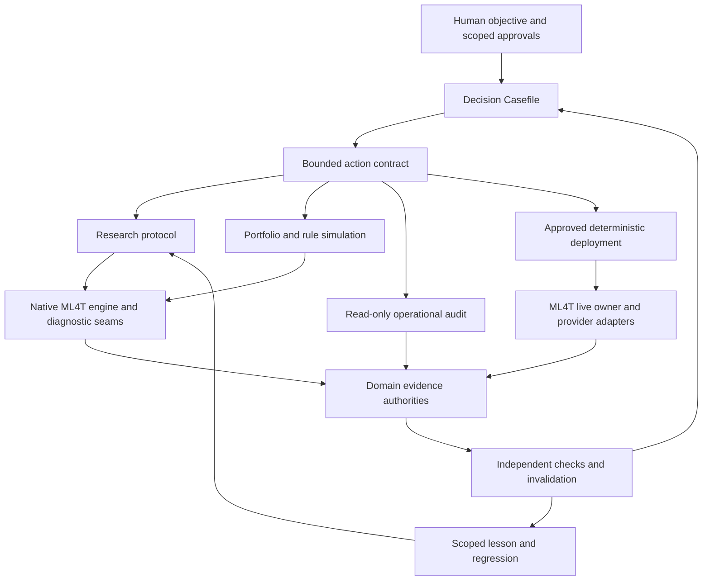

# Target system design

**Design status:** Selected direction for planning. All new interfaces here are
proposals until their rollout acceptance tests pass. Scope: research, portfolio,
optional prop deployment, operational audit and learning. No live action is
approved by this document.

## 1. The unit of work is a decision, not a script

A useful system lets a new agent answer a decision question without reconstructing
its history from directories. Each question has intent, scope, falsifier or
acceptance rule, authoritative inputs, uncertainty and a bounded next action.

Examples: reject or validate a thesis; admit a sleeve to a portfolio; qualify an
adapter; investigate a fill mismatch; approve a new rulebook; pause new risk.
These decisions have different owners but the same evidence grammar.

Measure valid decisions per total cost: human attention, tool/context usage,
compute, storage, elapsed time, capital at risk and irreversible data exposure.
Do not collapse these into a fake precision score. Safety and scientific integrity
are constraints; cost is optimized within them. Research completion, economic
support, execution readiness and authorization remain separate dimensions.

## 2. A tower of linked abstractions

| Level | Question answered | Stable interface | What remains below it |
| --- | --- | --- | --- |
| Mission | What outcome and limits did the owner choose? | Objective, allowed scope, budget, escalation conditions | Task decomposition and executor choice |
| Decision | What should happen next, and why? | Scoped Casefile with evidence and feasible action frontier | Directory scans, joins, status reconstruction |
| Contract | What may this action read/change, and how is completion proved? | Typed action and evidence contracts | Process commands and provider details |
| Domain | How does research, portfolio analysis or routing work? | Deep domain modules and explicit scientific protocols | Native library calls and state transitions |
| Mechanism | How is behavior executed and verified? | Native engines, pure policies, connector adapters, independent validators | API transport, calendars, matching details |
| Evidence | What actually happened, with what identity? | Domain journals, snapshots, artifacts and scoped attestations | Physical files and storage layout |

Upper levels refer to lower evidence by identity. Lower levels do not silently
change the mission or grant higher-level authority. The tower is a dependency
model, not six services or six databases.

## 3. Authority map: a shared view, not a global mutable registry

| Fact | Authority to retain or introduce | Derived consumers |
| --- | --- | --- |
| Historical data identity and eligibility | Canonical vault/catalog and immutable manifest; raw source provenance | Research, diagnostics, simulator |
| Thesis, trial and observed-history exposure | Existing frozen v1 records and new-mode trial ledger, each preserving its history | Cross-system Casefile and selection analysis |
| Feature or execution capability | Exact implementation identity plus bounded tests and qualification evidence | Capability projection and action preparation |
| Simulated orders, fills and cash | Native engine output, independently reconciled | Portfolio studies and reports |
| Real orders and fills | Raw venue events plus reconciled local execution journal | Runtime positions, audit and financial statements |
| Current account risk and pending reservations | One transactional risk/reservation owner per connected risk domain | Router, deterministic safety controller |
| Published firm rules | Immutable source captures and reviewed rulebook versions | Rule simulator and eligibility checks |
| Rules applicable to an account | Account agreement/program binding, effective time and approval | Live risk and replay |
| Capital/deployment permission | Human-approved, scoped, revocable authorization record | Runtime arming and protected actions |
| Verified payouts and business expenses | Reconciled cash ledger with external references | Business ROI and cashflow reporting |
| Job ownership and progress | Durable run registry plus process/checkpoint evidence | Recovery and Casefile |
| Reusable engineering lessons | Reviewed lesson with triggering scope and regression evidence | Retrieval and qualification checks |

A cross-system evidence index holds references, not editable copies of these
facts. Rebuild it from authorities. A conflict is visible; neither the newest
prose nor a numerically attractive result wins by default.

Keep simulated, shadow, demo and live namespaces distinct. A demo fill is never
joined to a live account by symbol alone. Keep account identifiers private and
redact tool views; retain stable internal references for reconciliation.

## 4. Deep modules and real seams

**Research runtime.** Retain vault, feature compiler, native diagnostics,
backtest adapter and accounting audit. Workbench and factory call the same
implementations. Choose a scientific protocol explicitly:

| Protocol | Signal/economic evidence | Execution evidence |
| --- | --- | --- |
| Cross-sectional forecast | PIT universe, train-only forward labels, IC/HAC and baseline | Neutral/long-only targets as declared; costs and funding |
| Single-instrument event | Preregistered event outcomes, baseline, dependence and cost feasibility | Actual session, next tradable price, entry/exit behavior |
| Path-dependent strategy | Native bounded test when a signal-only statistic cannot measure the thesis | Stop/target order, path ambiguity, gaps, fills and cash |

The current factory is cross-sectional. Other protocols are planned extensions,
not a renamed PASS or an excuse to use legacy bypass scripts. Native engine
semantics remain required. Forecast quality is neither net economic evidence
nor deployment readiness. Selection corrections must state the actual search
family and missing trials; changing the protocol cannot erase previous exposure.

**Portfolio evaluator.** Own source-aligned sleeve evidence, explicit sizing,
co-loss/stress analysis and comparison to simple baselines. Produce both standalone
and incremental portfolio effects. A return overlay and a combined native account
simulation are different capabilities. Request the latter only when routing,
margin, netting or intraday barriers make it necessary.

**Rule evaluator.** Implement pure, versioned transitions over account events and
rulebooks. Replay uses native simulated events; live uses reconciled venue events.
The same rule interpretation should serve both. This is not a substitute matcher,
custom backtest engine or automatic account-purchase service.

**Execution application.** Own approved deployment bindings, account eligibility,
atomic reservations, stable order identities, reconciliation and supervised
lifecycle. Provider-specific transport remains in `trading-connector`. Strategy
research and routing policy do not belong in the connector library.

**Audit evaluator.** Join immutable baseline, shadow intent, routing decision,
actual fill and cash evidence. Separate strategy, allocation, execution and data
faults before recommending research. It has read-only account access and no order
capability. Deterministic safety is a separate process and permission domain.

**Operating interface.** Hide evidence discovery and job mechanics behind the
small action surface in [agent_contracts.md](agent_contracts.md). This is the
primary deepening opportunity. It delegates to existing owners instead of
reimplementing them or exposing every filesystem operation to the model.

## 5. Version bindings and selective invalidation

A research result binds the spec, code tree, dependency lock, data view, causal
clock, cost model, protocol and attempted selection history. A deployment release
additionally binds strategy version, sizing policy, portfolio membership,
rulebook/account terms, connector capability, instruments/environment, approved
risk envelope and expiry/revocation policy.

A release manifest is a reference bundle, not permission by itself. A content hash
proves identity, not correctness, independence or authorization. A signature proves
an authorized issuer only when issuance keys and policies are outside the
research worker's control. Current cooperative hashes are not owner-proof security.

Use explicit dependency edges such as `computed_from`, `validated_against`,
`approved_for` and `supersedes`. A changed dependency marks the applicable current
claim stale; historical output remains true as a report of its old assumptions.

| Change | Invalidate or re-evaluate | Retain unchanged |
| --- | --- | --- |
| Fee/slippage assumption | Net economics and affected allocation/deployment comparisons | Gross feature values when independent of cost |
| Source/calendar/availability semantics | Affected features, outcomes, native run and decisions | Unrelated instruments and immutable historical records |
| Connector matching or order mapping | Affected execution qualification and deployment bindings | Research evidence not claiming those fills |
| Account program terms | Eligibility, headroom, payout simulation and applicable releases | Strategy signal math |
| Audit regime definition | Conditional audit baseline and calibration | Raw fills and account cashflow |
| Pure documentation correction | Documentation assurance | Numerical evidence unless the corrected assumption was used |

Cache computations only when complete input and implementation identities match.
A cache hit does not remove a trial, grant holdout access, or refresh live-state
freshness. Reuse unaffected evidence; recompute the changed dependency closure.
Avoid automatic reruns of every backtest after a cosmetic page change.

## 6. Human, agent and deterministic authority

The human chooses capital scope and non-reversible decisions. ChatGPT owns
architecture, scientific choice and acceptance. Use the healthy existing executor
advertised by DevSpace; prefer repository policy and current availability over a
provider name remembered from chat. Bounded specialist agents review independent
questions. One lead owns integration and shared edits.

Agents may inspect, explain, propose and execute authorized research/engineering
work. Permission is enforced outside their prompt. Protected history, release
arming, capital increases, new account purchases and material policy changes need
separate scoped authorization. Existing explicit standing approval can cover a
bounded program; ordinary retries do not need repeated human questions.

Approved deterministic safety rules can block new exposure, cancel opening orders
or perform specifically authorized risk-reducing actions without an LLM. There is
no promise that a software stop eliminates gap, liquidity or venue-outage losses.
A statistical audit flag cannot silently rewrite strategy parameters. Human
approval is not required for every order inside an already approved runtime policy.

## 7. Deployment and failure isolation

Start with Python modules and three fault/permission domains: research workers,
a read-only audit worker, and deterministic execution/risk. Schedule finite work
using the existing job tools; use durable supervised services for live runtime.
A browser/chat session is not the production scheduler. Independent watchdog
visibility and tested notification delivery are required.

Use Polars/Parquet for bulk evidence and DuckDB for analytical projections.
Retain existing native runtime journals. Where account reservations and an outbox
need atomicity, prefer one supported transactional store: stock SQLite on a
single-host/single-risk-owner deployment; reconsider PostgreSQL when actual
multi-host writers or availability requirements justify it. This is a proposed
integration choice, not an installed dependency or permission to replace journals.
Do not use an analytics file/CSV as a concurrent risk lock. Do not import an
experimental database's qualification claim from another project.

Initially colocate on the VPS with explicit CPU/RAM/I/O budgets and priorities.
Research backtests yield capacity to live risk and market-data handling. Observe
resource contention before separating hosts. A host outage remains a shared
failure domain; document recovery and off-host alert/backup limitations.

Grafana displays operating health; Marimo supports research exploration. Existing
HTML reports remain evidence presentations. A Vela integration, if used, consumes
immutable read-only events under its existing visualization-only boundary.
Neither a frontend nor a notification service owns orders, positions or permission.

## 8. Deliberately not built

No universal autonomous trading brain, graph database, generic workflow-platform
rewrite, mandatory ML allocator, always-on model conversation, or bespoke matcher.
No architecture claim that 100x more ideas means 100x more independent evidence.
No universal drawdown-correlation threshold or mandate to trade every day.
Unsupported scientific or execution semantics receive a precise capability gap.

Each new abstraction must remove caller-visible complexity, gain a tested seam,
and improve a measured agent task. Otherwise keep the simpler existing module.
