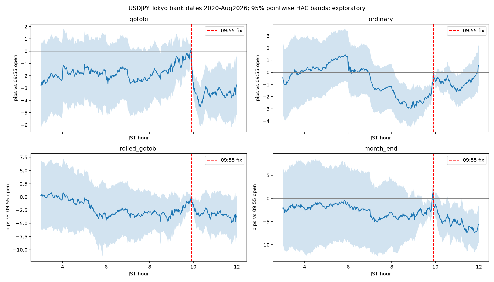

# Tokyo Fix / Gotobi Alpha Map — Program 1, v1

**Decision: NONE. Research is EXPLORATORY / NOT_APPROVED.**

The program completed phases A–D. No candidate passed the frozen gates. The conditional native backtest stage did not run. This is a research disposition. It is not approval to trade.

## Scope and frozen method

The mechanism is temporary USD demand from settlement activity before the 09:55 JST fixing. Reversal after the fixing is a separate hypothesis. Calendar labels do not observe importer demand or dealer flows. Ordinary Tokyo bank days provide the same-window baseline. The falsifier requires a positive controlled Gotobi increment, a positive net confidence lower bound at 1 pip, year stability, placebo specificity, and sufficient coverage.

The instrument is the canonical LSE USDJPY minute OHLC proxy. USD is the base currency. JPY is the quote currency. One pip is JPY 0.01 per USD. No specific retail broker contract, executable bid/ask, margin terms, historical spread, or capacity is verified. Costs of 0.8, 1.0, and 1.4 pips per round trip are hypothetical all-in costs.

The full 2020–August 2026 history was already inspected in prior studies. All estimates here are exploratory. No holdout outcome at or after 2026-09-01 JST was read. Source partition paths were filtered before hashing or reading. The timestamp boundary is 2026-08-31 15:00 UTC.

The YAML was frozen through the research-session CLI before outcome estimation. Its SHA256 is `877487a4ffed5c93a1d72c78183472b77857e152efef97a748335516d4dd7746`. The program uses 126 declared tests in one Holm family. This family includes some identical endpoint contrasts. The correction is conservative and does not imply 126 independent tests. The unknown legacy trial count prevents a reproducible DSR or PBO claim.

Event estimates use date-sorted statsmodels OLS with Bartlett HAC, maximum lag 5, finite-sample correction, and t intervals. Controlled increments adjust for weekday and year. Lag 1 and lag 10 checks are also recorded. Calendar regressions use nominal date classes, rolled dates, month-end, quarter-end, weekday, and year. No contemporaneous return, volume, or realized volatility enters the calendar adjustment set.

## Data and calendar gate

The official [BOJ closure rules](https://www.boj.or.jp/en/about/outline/holi.htm) and [Cabinet Office holiday calendar](https://www8.cao.go.jp/chosei/shukujitsu/gaiyou.html) define the bank calendar. Holiday dates include the 2020–2021 Olympic changes. Weekend or holiday Gotobi dates roll backward to the previous bank business day as a research assumption. This rule is not observed settlement flow. Month-end remains a separate category. February has no nominal 30th.

There are 473 nominal events and 470 distinct in-range Gotobi dates. Two roll collisions remain one event date. One nominal event rolls outside the start boundary. The boundary oracle verifies 2020-01-05 rolls to 2019-12-30. The calendar has 1,627 bank business days, 80 month-ends, and 26 quarter-ends. Historical announcement vintages are not archived. The extracted Japanese holiday names have encoding damage; ASCII dates remain intact.

Seven immutable annual snapshots contain 815,496 available minute rows. Each snapshot is below the CLI limits of 100 MB and 1,000,000 rows. The panel retains 999 dates with all 541 minute opens from 03:00 through 12:00 JST. It contains 306 Gotobi dates and 693 ordinary dates. The actual complete-session panel runs from 2020-01-10 to 2026-04-24. No date after April 24, 2026 meets the full-window rule, although the source snapshots retain available rows through August. The remaining 628 bank days are excluded. Prices are never forward filled.

Coverage is 61.4 percent. It is not random across weekdays or years. Monday has only 3 complete dates out of 303 expected. The weekly FX opening is a plausible explanation for early-Monday absence, but the source does not certify the reason for every missing minute. Additional gaps affect other weekdays. A timestamp-only audit finds that all 85 bank days after April 24 through August 31 lack 06:01, 06:02, and 06:03 JST. This explains why none meets the full-window requirement; the exact vendor outage or market closure cause remains unknown. The results identify associations in the retained cohort only. They do not establish effects across all Tokyo bank days. The frozen 80 percent coverage gate rejects strategy generalization.

| Year | Expected bank dates | Complete dates | Complete Gotobi dates |
| --- | ---: | ---: | ---: |
| 2020 | 243 | 53 | 15 |
| 2021 | 245 | 177 | 56 |
| 2022 | 244 | 176 | 57 |
| 2023 | 246 | 186 | 56 |
| 2024 | 245 | 180 | 55 |
| 2025 | 243 | 173 | 51 |
| 2026 | 161 | 54 | 16 |

The source selection covers January–August 2026. The retained 2026 complete-session row covers 2026-01-06 through 2026-04-24 only. The new Gotobi count does not match the prior 492 trades because the prior study added month-end to Gotobi and required only 08:00–10:30 completeness. The new calendar separates month-end and requires the full 03:00–12:00 window.

## A — When does pressure begin?

**The program cannot establish an onset time.** No fixed pre-fix interval has a controlled positive increment that survives Holm. The 07:00–08:30 raw controlled estimate is positive, but the adjustment removes its statistical support. The minute chart has pointwise 95 percent HAC bands centered at the 09:55 open. The chart is descriptive. It does not provide simultaneous bands or a minute optimizer.

| JST interval, long markout | Gotobi mean pips | Ordinary mean pips | Controlled increment pips | 95% HAC interval for increment | Holm p |
| --- | ---: | ---: | ---: | --- | ---: |
| 0300–0500 | +1.325 | +0.947 | +1.660 | [-0.776, +4.097] | 1.000 |
| 0500–0700 | -0.541 | -0.848 | +0.011 | [-2.881, +2.904] | 1.000 |
| 0700–0830 | -0.303 | -2.183 | +2.363 | [+0.374, +4.351] | 1.000 |
| 0830–0954 | +2.206 | +1.857 | -0.565 | [-3.518, +2.388] | 1.000 |
| 0956–1010 | -2.036 | -0.103 | -1.977 | [-3.402, -0.551] | 0.783 |
| 1010–1030 | +0.049 | -0.047 | -0.262 | [-1.608, +1.084] | 1.000 |
| 1030–1200 | +0.723 | +1.190 | -0.578 | [-3.050, +1.895] | 1.000 |

The 08:30–09:54 Gotobi mean is +2.206 pips. Its mean after 1 pip is +1.206, with a 95 percent interval of [-0.889, +3.301]. The adjusted Gotobi premium is -0.565 pips, with interval [-3.518, +2.388]. The prior positive unadjusted Gotobi premium is not verified in this stricter cohort.

| Pre-fix entry; exit 09:54 | Gross pips | Net at 0.8 pip | Net at 1.0 pip | Net at 1.4 pip |
| --- | ---: | ---: | ---: | ---: |
| 0300–0954 | +2.687 | +1.887 | +1.687 | +1.287 |
| 0500–0954 | +1.362 | +0.562 | +0.362 | -0.038 |
| 0700–0954 | +1.903 | +1.103 | +0.903 | +0.503 |
| 0830–0954 | +2.206 | +1.406 | +1.206 | +0.806 |

## B — Does unconditional post-fix reversal improve?

Ungated Gotobi post-fix shorts have positive point means and outperform the original extension gate in this cohort. The ordinary-day short has negative net expectancy at the base cost at each horizon. No controlled Gotobi reversal premium survives Holm. No Gotobi net lower confidence bound is positive at 1 pip. Do not choose the largest point mean as a winning horizon.

| Exit from 09:56 short | Group | n | Gross pips | Net at 1 pip | 95% gross HAC interval |
| --- | --- | ---: | ---: | ---: | --- |
| 1010 | B0 ordinary | 693 | +0.103 | -0.897 | [-0.586, +0.792] |
| 1010 | B1 Gotobi | 306 | +2.036 | +1.036 | [+0.959, +3.114] |
| 1010 | B2 month-end | 54 | +2.000 | +1.000 | [-1.291, +5.291] |
| 1010 | B3 original gate | 21 | -1.724 | -2.724 | [-5.722, +2.274] |
| 1010 | Strict full-window gate | 24 | -1.529 | -2.529 | [-4.586, +1.528] |
| 1030 | B0 ordinary | 693 | +0.149 | -0.851 | [-0.824, +1.123] |
| 1030 | B1 Gotobi | 306 | +1.987 | +0.987 | [+0.323, +3.651] |
| 1030 | B2 month-end | 54 | +2.374 | +1.374 | [-0.577, +5.325] |
| 1030 | B3 original gate | 21 | -2.843 | -3.843 | [-6.940, +1.254] |
| 1030 | Strict full-window gate | 24 | -1.079 | -2.079 | [-5.437, +3.279] |
| 1100 | B0 ordinary | 693 | +0.919 | -0.081 | [-0.264, +2.101] |
| 1100 | B1 Gotobi | 306 | +1.775 | +0.775 | [-0.180, +3.730] |
| 1100 | B2 month-end | 54 | +3.780 | +2.780 | [+0.057, +7.502] |
| 1100 | B3 original gate | 21 | -3.657 | -4.657 | [-9.818, +2.504] |
| 1100 | Strict full-window gate | 24 | -2.925 | -3.925 | [-8.946, +3.096] |

The original gate compares the 08:00–09:55 open extension with 1.5 times the sample standard deviation from the preceding 20 complete 08:00–10:30 bank sessions. The strict gate uses preceding full-window sessions. Both exclude the current date. Original-gate history is stored separately. Its 21 retained Gotobi events differ from the prior 45 because of the new event definition and full-day cohort. Strict-gate n is 24. Both samples are below the frozen strategy minimum of 100. Month-end summaries overlap Gotobi and ordinary groups: 30 of 54 month-end dates are Gotobi, and 24 are ordinary. These group counts must not be added as independent samples. Identically gated ordinary controls are used. Conditioning on an extension can select a mediator; this cannot identify total settlement effects.

| Gotobi short exit | Net at 0.8 pip | Net at 1.0 pip | Net at 1.4 pip | Base net win rate | Base net profit factor | Endpoint drawdown, pips |
| --- | ---: | ---: | ---: | ---: | ---: | ---: |
| 1010 | +1.236 | +1.036 | +0.636 | 50.7% | 1.354 | -90.6 |
| 1030 | +1.187 | +0.987 | +0.587 | 53.6% | 1.231 | -212.1 |
| 1100 | +0.975 | +0.775 | +0.375 | 52.3% | 1.145 | -239.7 |

Profit factor, win rate, and additive endpoint drawdown use native ML4T analytics on event markouts. These are not executed fills, a USD capital account, or intratrade marked-to-market drawdown. No Sharpe is reported because no qualifying native capital-account backtest ran.

## C — Which settlement days differ?

Two regressions estimate 08:30–09:54 long and 09:56–10:30 short markouts. Each has full design rank 20/20 after excluding one retained collision date. Nominal classes are mutually exclusive. Rolled, month-end, and quarter-end labels enter the same model. The Monday reference has only three complete observations, which weakens weekday interpretation. All calendar coefficients have Holm p=1.000. There is no verified ranking of nominal settlement dates.

| Calendar class | n | Pre-fix coefficient pips | 95% HAC interval | Post-fix short coefficient pips | 95% HAC interval |
| --- | ---: | ---: | --- | ---: | --- |
| nominal_5 | 46 | -6.964 | [-13.330, -0.598] | +0.166 | [-4.434, +4.765] |
| nominal_10 | 54 | -4.438 | [-9.684, +0.808] | +0.623 | [-2.745, +3.992] |
| nominal_15 | 53 | +1.608 | [-4.440, +7.657] | +3.892 | [+0.014, +7.770] |
| nominal_20 | 54 | +1.706 | [-3.430, +6.841] | +4.789 | [+0.393, +9.185] |
| nominal_25 | 51 | -0.217 | [-5.485, +5.051] | +2.576 | [-0.996, +6.149] |
| nominal_30 | 47 | -1.286 | [-10.134, +7.562] | +0.148 | [-4.580, +4.877] |
| rolled_gotobi | 107 | +2.152 | [-3.204, +7.509] | +0.098 | [-3.350, +3.546] |
| month_end | 53 | -0.787 | [-8.890, +7.315] | +2.996 | [-1.514, +7.506] |
| quarter_end | 17 | +11.282 | [-4.156, +26.719] | -1.350 | [-8.719, +6.018] |
| weekday_4 | 252 | -1.937 | [-8.718, +4.843] | -0.957 | [-8.468, +6.554] |

Quarter-end has only 17 retained events. It fails the category minimum of 30 and is inconclusive. Nominal classes have 46–54 events. Their raw signs vary. For example, the nominal fifth pre-fix coefficient is negative, while the fifteenth and twentieth post-fix coefficients are positive before multiple-testing correction. These patterns are exploratory associations.

## D — Refutation, years, and costs

Matched pre-fix and 11:55-placebo windows are 09:30–09:54 versus 11:30–11:54. The controlled difference is -0.927 pips, interval [-2.985, +1.132], Holm p=1.000. Matched four-minute post-fix shorts are 09:56–10:00 versus 11:56–12:00. The controlled difference is +0.739, interval [-0.263, +1.742], Holm p=1.000. The 14-, 34-, and 64-minute post-11:55 endpoints lie outside 12:00 and are unavailable. The four-minute placebo cannot validate the main longer horizons.

Negative-control nominal dates 2/7/12/17/22/27 roll backward under the same bank-day assumption. Actual Gotobi collisions are excluded. The controlled negative-calendar coefficients are +1.581 pips pre-fix and +1.106 pips post-fix. Their intervals include zero and Holm p=1.000. Absence of significance is not proof of fixing specificity.

The gross Gotobi 09:56–10:10 mean survives the program-wide Holm correction (p=0.0296). That is a mean against zero. Its premium against ordinary-day controls does not survive correction (p=0.7829), and its base net interval includes zero. These are different claims.

| Year | Gotobi n | 08:30–09:54 net pips | 09:56–10:10 short net pips | 09:56–10:30 short net pips | 09:56–11:00 short net pips |
| --- | ---: | ---: | ---: | ---: | ---: |
| 2020 | 15 | +1.707 | -0.820 | +0.740 | +0.327 |
| 2021 | 56 | +2.412 | +0.262 | +0.041 | -0.152 |
| 2022 | 57 | +1.802 | +0.433 | +3.707 | +2.119 |
| 2023 | 56 | -0.048 | +1.236 | +0.530 | -0.412 |
| 2024 | 55 | +3.236 | +1.613 | +0.705 | +1.609 |
| 2025 | 51 | -2.367 | +2.725 | +1.200 | +1.727 |
| 2026 | 16 | +3.188 | -0.431 | -3.269 | -2.100 |

The pre-fix mean declines from +3.236 net pips in 2024 to -2.367 in 2025. Ungated post-fix shorts do not show the same 2024–2025 deterioration in this cohort. The longer post-fix horizons become negative in the retained January–April 2026 dates. Sparse 2020 coverage and absent complete May–August 2026 dates prevent a firm regime conclusion. Leave-one-year-out and HAC-lag outputs are retained in results.json. These checks do not create unseen OOS evidence.

## Hypothesis ranking and disposition

1. **B: ungated post-fix reversal.** Most useful next research question. Gross mean evidence exists in the retained Gotobi cohort. Controlled premium, net lower bounds, placebo specificity, and coverage gates do not pass.
2. **A: pre-fix pressure.** Positive cumulative point means exist. Timing and incremental Gotobi premium remain unresolved after controls and Holm.
3. **C: settlement subdivisions.** No corrected category evidence. Quarter-end is too small.
4. **B3: extension-gated short.** Negative net estimates at every fixed horizon, small samples, and mediator-selection risk.

**Defensible candidates: NONE.** All seven ungated candidates and six gated candidates fail recorded gates. There are zero native Engine simulations. The proposed conditional execution contract remains USD 10,000 initial equity, fixed USD 10,000 notional, previous-available-bar decisions, NEXT_BAR OPEN fills, no compounding, and explicit JPY-to-USD translation. No such fills or USD performance are claimed here.

## Observed, inferred, and unknown

- **Observed:** snapshot identities, full-window coverage, official calendar dates, event markouts, HAC estimates, Holm adjustments, year signs, and candidate failures.
- **Inferred:** calendar-linked settlement demand could explain the pattern; weekly opening could explain some early-Monday absence. The program does not observe those flows or validate every gap cause.
- **Unknown:** historical executable spreads, broker contract and financing terms, raw tick-to-bar parity, historical calendar announcement vintages, and the effect on excluded days. The September 2026 onward holdout remains untouched.

The next decisive question is whether a fixed post-fix reversal premium remains positive in a new, coverage-appropriate cohort with verified executable quotes. A new specification must define weekday availability and complete interval coverage before results are read. It must retain the existing holdout boundary. This mission does not authorize opening that holdout.

## Evidence and verification

- [Frozen config](../../config/research_sessions/tokyo_alpha_map_program1_v1.yaml).
- [Source and snapshot identities](../../data/processed/tokyo_alpha_map_program1_v1/source_manifest.json).
- [Calendar audit](../../run_log/tokyo_fix_alpha_map_program1_20261010/calendar_audit_v1/audit.md).
- [Gap audit](../../run_log/tokyo_fix_alpha_map_program1_20261010/execution_v1/gap_audit.json).
- [Independent missing-minute audit](../../run_log/tokyo_fix_alpha_map_program1_20261010/root_verification_v1/missing_minute_details.json).
- [Window table](../../run_log/tokyo_fix_alpha_map_program1_20261010/execution_v1/window_table.csv).
- [Results, regressions, costs and screen](../../run_log/tokyo_fix_alpha_map_program1_20261010/execution_v1/results.json).
- [Trial ledger](../../run_log/tokyo_fix_alpha_map_program1_20261010/execution_v1/trial_ledger.json).
- [Independent verifier](../../run_log/tokyo_fix_alpha_map_program1_20261010/root_verification_v1/independent_verification.json).
- [Statistical review](../../run_log/tokyo_fix_alpha_map_program1_20261010/stat_review_v1/post_outcome_review.md).
- [Interval availability counts](../../run_log/tokyo_fix_alpha_map_program1_20261010/execution_v1/interval_availability.csv).

The independent verifier passed: 999 exact full-window dates, 18 fixed markouts, both past-only gates, calendar regressions, all 126 Holm adjustments, curve anchors, and 18 protected-file hashes. The CLI input checks pass with no issues. Five mission tests pass with six existing third-party SHAP warnings. Python compilation and git diff --check pass.

One preparation attempt failed on calendar CSV type inference before source read. The error log is retained, and string schema overrides resolved the failure before freeze. A calendar boundary defect was also corrected before freeze. No older frozen study was edited. GitHub state and existing host tmux jobs could not be inspected because sandbox access failed. No commit, push, or live trading occurred.

The suite without `tests/test_notebook_dag.py` passes: 268 passed, 1 skipped, and 9 third-party warnings in 92.10 seconds. The full suite recorded five failure markers and then stalled without a terminal summary. It was interrupted with exit code 130. Exact failure locations and tracebacks were not available in that log. The standalone Marimo check also stalled with no output and was interrupted. The notebooks were not edited. These checks did not pass; no zero-warning notebook claim is made. See [verification status](../../run_log/tokyo_fix_alpha_map_program1_20261010/root_verification_v1/verification_status.json) and the retained logs. All pre-existing tracked working-tree changes are preserved byte-for-byte.
