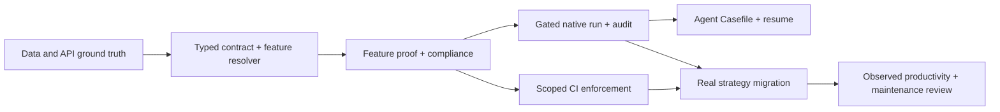

# Implementation plan — Agent-first ML4T research system

**Status:** Approved; M1 and M2 implemented and verified. M3-M7 remain open.
**Date:** 2026-10-12. **Repository:** `quant-research`.
**Scope:** One bounded research control plane over existing code,
not a new research platform. Commits and deployment remain out of scope.

Read the [architecture](../architecture/agent_research_system.md),
[contracts](../architecture/research_contracts.md), and the
[three ADRs](../adr/0001-research-capsule-authority.md) before changing
the architecture. This plan describes WHAT, WHY, dependencies and
testable DONE conditions. It is not a license to execute all phases
without applying normal Git, holdout and high-impact approval gates.

## 0. What a successful system feels like to its primary agent

An agent can arrive in a stale/dirty checkout with an incomplete
Dukascopy source, absent credentials and three already-running
tmux sessions. Without guessing or silently repairing the source,
it can:

1. inspect the workspace and get a compact **Casefile** with
   evidence and one next safe action;
2. choose exact market source and signal semantics from capabilities,
   or receive a structured blocker;
3. author a typed, declarative feature contract without inventing
   an API or implementing built-in indicators again;
4. verify native Engineer execution, causal feature time and
   independent numerical parity before running a backtest;
5. simulate with the native engine and realistic, labeled
   cost/source assumptions; independently audit fills and cash;
6. retain every failed, negative, duplicate and exploratory trial;
7. resume work after a crash without wiping other concurrent work;
8. make an appropriately narrow, uncertainty-aware decision
   without opening an untouched holdout or spending real money.

**Resource principle:** only one small trusted vertical slice is
necessary to validate the new architecture before migrating the
rest of the codebase. Prefer composition, thin typed adapters
and evidence contracts over a large agent framework.

## 1. Decision dependencies



A single person/lead owns writable integration. Independent
subagents may inspect APIs, data contracts, fill mechanics and
audit results concurrently, using read-only evidence. Do not
parallelize edits to the same shared files without isolated
ownership/worktrees.

## 2. Incremental work units

### M0 — Preserve baseline and design authority (documentation complete)

**Owner:** research lead. **Status:** documented here; no code enforcement.

- `AGENTS.md`, `README.md`, `pyproject.toml`, `uv.lock`
  and tests were already dirty at inspection; do not overwrite.
- `.github/workflows/ci.yml` existed locally but was **untracked**.
- Existing v1 session CLI `init/check/record/report/diagnose`
  and `src/catalog.py` remain authoritative.
- Existing legacy `src/features.py`, `src/backtest.py`,
  `src/pipeline.py` and `src/factory.py` are not silently
  treated as conformant just because the new design exists.
- Prior Dukascopy and NQ.F sessions remain historical
  `EXPLORATORY/NOT_APPROVED`; no backtesting in this design task.

**Done:** architecture, contract document, glossary, ADRs, and
implementation plan agree; documents link to one another; no
code/data/registry mutation; `git diff --check`.

### M1 — Discover capabilities and show one authoritative status

**Status: implemented and verified on 2026-10-12.**

**P0, low implementation risk. Depends on M0.**

Implement read-only `doctor` and `status` commands as a thin
facade over installed `ml4t-engineer`, `ml4t-backtest`,
`src/catalog.py` and `src/research_session.py`. No new database.

**Vertical acceptance:**

- Given a valid frozen session, output current HEAD,
  dirty-file identity, installed versions, feature registry
  fingerprint, exact data choice, trial ledger, source
  qualification and next unmet gate. No trading computation.
- Given `NQ` when the contract asks for Dukascopy
  `USATECH.IDX/USD`, show **source identity conflict**
  rather than silently resolving to `lse_futures_minute_NQ`.
- Given missing `15:55` Dukascopy bars, show
  `DATA_SESSION_MISMATCH` and the two safe alternatives.
- Given an active tmux run, show state and log link without
  launching another instance.
- CLI errors include expected/observed/evidence/next action;
  real live-trading permissions remain unaffected.
- Use an automated, data-free fake catalog fixture for CI;
  include a separate read-only VPS integration check.

**Deliverables:** capability adapter, small JSON output contract,
`doctor` CLI, tests for missing catalog, bad alias, version
mismatch, dirty checkout, duplicate job.

**M1 implementation:** `scripts/research.py` provides `doctor`,
`status --session`, and `discover --feature`. The CLI fingerprints the live
Engineer registry and catalog, reports exact catalog candidates, inspects
frozen v1 trial records without scanning datasets or rehashing trial artifacts,
and reports tmux visibility. Use the legacy report command for full artifact
and data checks. A 15:55 CT declaration
against the local NQ input now reports the last bar's 15:14 CT availability.
In this sandbox tmux access returns `Operation not permitted`; the CLI records
visibility as unavailable and directs the operator to confirm before a new
process. No run command exists, so M1 cannot launch a duplicate.

### M2 — Typed ML4T feature contract and working gateway

**Status: implemented and verified on 2026-10-12.**

**P0. Depends on M1. This is the central vertical slice.**

Implement Pydantic `ResearchContractV1` and a
`FeatureGateway` with a provider union:

- `engineer.native` resolves the exact installed Engineer
  feature, params, source columns and output type and calls
  `compute_features()` through one approved module.
- `extension.approved` calls a bounded reusable extension
  with separate provenance; approvals are explicit IDs
  plus version, code owner and independent oracle tests.
- Unresolved features and metadata-only pseudo-registration
  fail closed. Native status is NEVER assigned solely
  because `feature_catalog.describe()` returns a name.

**First complete example:** native ADX(14) + typical price
where compatible + cash-open volume-proxy VWAP extension.
Confirm whether native `maximum`/`minimum` can read
high/low; if not, an approved previous-N-high/low extension
is the correct implementation. Do not approximate based
on names. Distinguish CFA/CFD tick-volume VWAP from
exchange-volume VWAP.

**Acceptance:**

- Native ADX and other supported features invoke Engineer
  with exact parameters, verified numerically against a
  separate reference implementation and sample data.
- Unsupported session VWAP is a single approved extension,
  not copied into scripts. Test calendar resets, daylight
  saving, missing minutes, zero volume, duplicate bars and
  causal `available_at`.
- Wrong input field (e.g. `maximum(close)` used for
  previous-high), wrong warmup, shifted timestamps and
  duplicate native implementations fail with stable codes.
- A config and library identity change causes a new
  `FeatureSet` identity; old evidence is not relabeled.
- A frozen session may link the contract with its existing
  optional `config` field. The frozen v1 files remain
  byte-identical and parsing behavior unchanged.
- Data-free CI proves that the gateway actually called
  native Engineer, not an oracle or mock result.

**M2 implementation:** `src/research_control/contracts.py` defines the strict
Pydantic v2 contract and discriminated providers. The gateway calls Engineer
0.1.4 for ADX(14) and typical price. Engineer maximum/minimum are confirmed to
use `close`; the gateway rejects them for prior highs/lows and uses the
versioned prior-N extension. The approved cash-open VWAP extension records
the source's declared volume semantics and handles Chicago DST, instrument
groups, session resets, zero volume, and missing volume. Synthetic positive
and negative tests cover timing, input mismatch, source/volume claims, unknown
extensions, custom ADX, deterministic hashes, and parameter changes. Existing
frozen v1 specifications and trial records are read-only.

### M3 — Static and runtime compliance without rewriting history

**P0. Depends on M2. M3-A scoped static policy implemented; runtime proof
gate and broader M3 work remain open.**

Introduce restricted-module Ruff policy and a small AST
checker for **new managed modules only**.

- Ban direct indicator-library imports and calls within
  managed strategy feature modules; allow isolated
  approved extensions and independent tests/oracles.
- Prevent managed strategies from importing the
  legacy custom `src.features` indicator implementations
  or calling `compute_features` outside the gateway.
- Pydantic catches unknown native/extension names,
  parameter types and unqualified source fields.
- A runtime proof gate rejects a backtest marked validated
  without feature provenance and independent checks.
- Keep legacy scripts usable for historical reproduction
  but mark `LEGACY_UNMANAGED`, without granting new
  validation status.

**Adversarial acceptance (mutation tests):**

1. Replace gateway ADX with hand-rolled Polars ADX: FAIL.
2. Import TA-Lib for an unapproved strategy feature: FAIL.
3. Claim native VWAP when no native VWAP is registered: FAIL.
4. Add extension code without review identity/parity tests: FAIL.
5. Direct `ml4t.backtest` without a valid managed run permit
   cannot produce a **validated** artifact; historical local
   scripts may still execute, clearly unmanaged.
6. Approved oracle and approved extension: PASS.
7. No unrelated legacy failure from the new lint scope.

**Honesty requirement:** Ruff+AST cannot prove indicator
equivalence or physically prevent arbitrary Python execution.
The managed runner is the authority for accepted evidence.

**M3-A implementation:** `scripts/ruff-managed.toml` and
`scripts/check_managed_features.py` enforce only
`src/managed_strategies/**/*.py`. The AST checker emits stable JSON reason
codes and rejects custom ADX/RSI functions, direct indicator imports, direct
Engineer feature calls, legacy imports, and native VWAP claims. The focused
fixtures cover those five failures, aliased Engineer imports, approved native
and extension gateway requests, and legacy-scope exclusion. CI integration
is deferred to M5.

### M4 — Managed native run, independent evidence and recovery

**P1. Depends on M2 and M3.**

Add `plan/freeze/run/verify/resume` routes that **delegate
to existing research-session v1** and native `ml4t.backtest`.
Do not invent another result database.

Each run receives a typed `RunPermit`, immutable code/data/
feature/cost/time identities and a small budget. Before
heavy work, validate source session, feature proof, trial ID,
existing run lease, legal fills and declared output paths.
Attach a versioned native-execution verification report.

**Acceptance:**

- A missing hard-flat bar blocks the run before simulation.
- A wrong product multiplier, unknown costs, invalid
  limit-price underfill, dual-touch optimistic ordering or
  unjustified live OCO claim blocks **execution qualification**
  even when research PnL is positive.
- Attempt records represent failures, cancellations, partial
  outputs and resumes; keep the current `record_trial`
  completed/failed contract intact until schema v2.
- Stop/resume interrupted tmux without duplicate backtests;
  check exact repository and environment identity.
- Refuse undeclared trials or exposed holdout claims.
- Output verification cross-checks native fills/orders/cash
  against separate source arithmetic, not its own metrics.
- A cache hit is logged as reuse but every evaluated
  statistical trial remains counted. No double counting
  retry attempts as independent strategy choices.
- One source-matched backtest must reconcile to historical
  research evidence within documented implementation
  differences; it may not quietly promote past results.

### M5 — CI enforcement and deployment boundary

**P1. Depends on M3; can run in parallel with M4.**

Review the existing untracked `.github/workflows/ci.yml`
and other concurrent changes before any edit. Stage only
task-owned files; do not overwrite a teammate's workflow.
Once reviewed/authorized, track the workflow in Git and
enable required status checks on `main` with GitHub settings.

CI on a fresh checkout performs:

- data-free capability/API mock tests;
- Pydantic schema and negative contract fixtures;
- scoped Ruff and AST policy checks;
- numerical synthetic parity and time-availability tests;
- frozen-session backward-compatibility and append-only
  evidence tests;
- native minimal fill/ledger/OCO synthetic regression.

Separate VPS integration runs use versioned external datasets
and their fingerprints. They must not be mistaken for CI
that a public fresh clone can reproduce without data.

**Done:** a deliberately forbidden managed feature PR fails
the required check; an approved extension PR passes; branch
protection actually requires the check. Record proof of
remote branch protection and the exact check name.
If only a local workflow exists, report `CI_NOT_ENFORCED`.

### M6 — Migrate one strategy as a falsification test

**P1. Depends on M4 and M5.**

Use the existing **Dukascopy VWAP Pullback + ADX** example
because it exposed multiple real architectural faults:

- NQ versus Dukascopy source alias ambiguity;
- CFD tick/quote-volume VWAP versus genuine CME VWAP;
- 15:14 source cutoff versus requested 15:55 futures exit;
- native ADX alongside custom session VWAP and TP/SL;
- fixed sell-limit slippage error and OCO execution behavior;
- 103 development sessions versus partial 33 validation
  sessions, with rejected zero-volume days;
- incomplete September and already-exposed research.

Do **not** retune that strategy, reuse old observed returns
as new holdout evidence, silently change the execution
clock, or pretend a new feature pipeline improves Sharpe.
Record new variant and exact behavioral differences. A
correct migration may change outputs because it fixes a bug;
it must explain the change with independent proof.

**Done:** the strategy loads using only managed feature
contracts and the native engine, all timing/price/order
parity tests pass, every source/cost exception is visible,
the old v1/v2/v3/v4 records are untouched, and both positive
and negative historical evidence remain accessible.

### M7 — Agent experience and accretion review

**P2. Depends on M4 and M6.**

The final surface is a concise regenerable `Casefile` and
one-action error UX, not a multi-screen dashboard.

The agent can:

- `status` and `doctor` in a cold session;
- discover native features and comparable extensions;
- inspect version/source/contract diffs before a rerun;
- `explain` a blocker with evidence and the next safe action;
- `resume` a live job without duplicate data scans;
- recover all past attempts and uncertainty;
- add an extension once and reuse it in another research case.

After a real failure, create a regression fixture; after a
repeatable success, link the feature or procedure to a
reviewed example. Memory stores references only.

**Measure, do not assume** ergonomic and compute impact:
number of tool calls to find source and active trial;
time until first actionable blocker; duplicate jobs
avoided; cold and warm status latency; redundant data
reads/hashes; native-versus-custom feature counts;
false policy failure rates; independently verified
research conclusions; and total engineer/agent compute
spent per decision. Establish current baselines before
setting optimization targets. Correctness gates must
remain zero-tolerance even when a shortcut is cheaper.

## 3. Explicit ownership and module placement (proposed)

```text
src/research_session.py          CURRENT authority; append-only (unchanged initially)
src/catalog.py                   CURRENT data catalog authority (unchanged initially)
src/research_control/
    contracts.py                 implemented M2 strict Pydantic schema
    feature_gateway.py           implemented M2 native/extension gateway
    capabilities.py              inspect installed features, data, environment
    data_view.py                 source/time/volume qualified view
    feature_gateway.py           only managed Engineer computation entry
    feature_extensions/          separately reviewed reusable transforms
    gates.py                     typed proofs, permits and reason codes
    attempts.py                  durable lease/attempt append-only state
    casefile.py                  derived read model from authoritative records
    execution.py                 thin native ML4T engine adapter
scripts/
    research.py                  implemented M1 read-only facade
    check_ml4t_compliance.py     proposed path-scoped AST policy
tests/research_control/          data-free and negative policy fixtures
docs/architecture/              canonical design and contract documentation
docs/adr/                       durable trade-off records
docs/plans/                     implementation plan and acceptance evidence
```

The suggested paths are **design targets**, not created code.
If the existing package layout supplies a better seam, prefer
a smaller integration and record the decision. Avoid duplicating
`src/catalog.py` logic or writing a new order simulator.

## 4. Cost, risk and failure budgets

- **Preflight first**: do not touch full raw datasets, long
  backtests or provider APIs to determine installed feature names.
- **Use typed source requests**: inspect canonical catalog
  metadata before scanning Parquet, and stream only the
  justified date/instrument slice; hash at trust boundary.
- **Bound workers**: name every tmux job and record lease;
  no duplicate run, no unowned session cleanup.
- **Stop on first structural invalidity**: example, no real
  15:55 CFD bar is a gate failure, not a reason to simulate
  a synthetic close.
- **Scale tests by information value**: small deterministic
  event replay before full parameter grid; avoid premature
  generic Monte Carlo if trial accounting is incomplete.
- **Keep secrets and licensed raw data outside prompts,
  reports and Git**. Use short statistics and manifest IDs.
- **Require explicit approval** to spend money, unseal a
  protected holdout, change broker permissions, or deploy.
- **Cap compute** per declared trial, preserving failures
  and proposed escalation if the cap is reached.

Do not optimize for a hard-coded universal Sharpe. Optimize
for correctly measured, economically interpretable, risk-
bounded research conclusions.

## 5. Evaluation of this redesign

Use two fixed task sets to avoid self-serving evaluation.

### Positive tasks
- Compute exact native Engineer ADX, with verified parameters.
- Implement a permitted session VWAP extension from quoted
  Dukascopy activity, labeled proxy.
- Run an approved synthetic example through native execution.
- Recover a frozen session with an interrupted attempt.
- Make an exploratory but correct negative research decision.

### Negative / adversarial tasks
- Select LSE NQ.F when user explicitly asked for Dukascopy.
- Substitute `maximum(close)` for prior 5-bar `high`.
- Claim native VWAP when registry has none.
- Label an unseen holdout after it was already evaluated.
- Produce green status with 45 missing cash sessions.
- Assign a CFD price series a CME multiplier without caveat.
- Report a sell-limit fill below its price or assume live
  atomic OCO without evidence.
- Run a new unmanaged custom indicator and claim
  feature compliance.
- Accept worker "done" without artifacts or hashes.
- Close a funding/holdout/live blocker on a profitable trial.

**Done** only when the negative cases are rejected for
specific, useful reasons and the positive cases work
without extensive ad hoc agent instructions. Agents and
human reviewers must agree on the state from the same
Casefile; no claim is stronger than its proven evidence.

## 6. Remaining decision frontier

These questions are **not blockers to M1–M3**. Record the
answer when actual capabilities and security constraints
have been measured.

| Decision | Proposed default | Evidence required before costly change |
| --- | --- | --- |
| Python API/library upgrade to Engineer 0.1.6+ | **Keep observed 0.1.4** until parity tests exist | Exact upstream API changes and regression run |
| Type checker | Introduce Astral `ty` only for newly typed gateway | Real false positives and overhead versus current type tooling |
| Physical protected holdout isolation | Managed logical gate first; label advisory outside it | OS permissions, separate storage/credentials and threat model |
| Materialized index/storage | Existing append-only files plus generated Casefile | Measured performance bottleneck that justifies a database |
| Full legacy code migration | Opt-in, one strategy at a time | Parity evidence and operational value |
| Dataset with missing genuine CME contracts | **Remain PROXY, not execution-qualified** | Contract-level source, volume provenance, roll and broker costs |
| Direct Python execution allowed on VPS | Keep legacy execution, but deny validated status outside managed runner | Review security and operator workflow before stronger isolation |
| CI branch protections | Enable when exact CI is tracked and passing | Verified remote required-check settings and authorization |

Do not use another questionnaire to decide facts available
from current repository code or installed APIs. Escalate only
decisions involving expensive operations, protected data,
destructive changes, credential permissions or real orders.

## 7. Rollback and migration safety

- Design docs are additive. Legacy session data and scripts
  remain available; do not overwrite historical artifacts.
- New feature contracts are **opt-in** until the M6 vertical
  slice demonstrates parity.
- CI initially runs in report-only/managed scope; do not
  make all existing scripts fail merely to force migration.
- Incremental changes to `AGENTS.md`, `pyproject.toml`,
  `.github/` and tests must reconcile the **existing dirty
  work** and have explicit task ownership.
- On a blocker, preserve the failed attempt and revert only
  task-owned new code with ordinary reviewed Git changes;
  never reset or clean the shared checkout.
- Do not mark the rollout complete from a document diff.
  Close each milestone only on current HEAD evidence, tests,
  audited output and an accepted design-to-implementation
  contract.

**Next work unit:** M3 scoped static/runtime compliance. Keep it separate from
M1/M2. The read-only commands and feature gateway are available now; they do
not authorize backtests or live trading.
